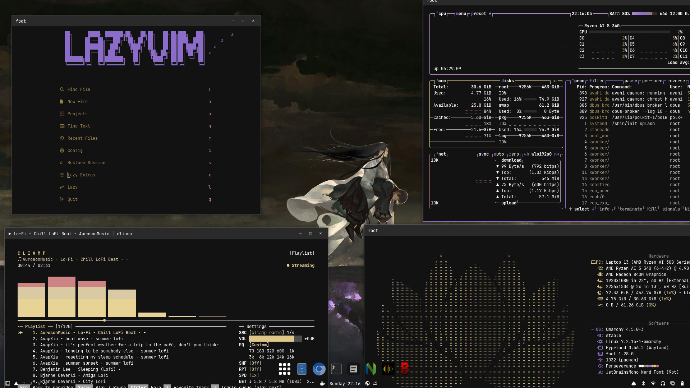
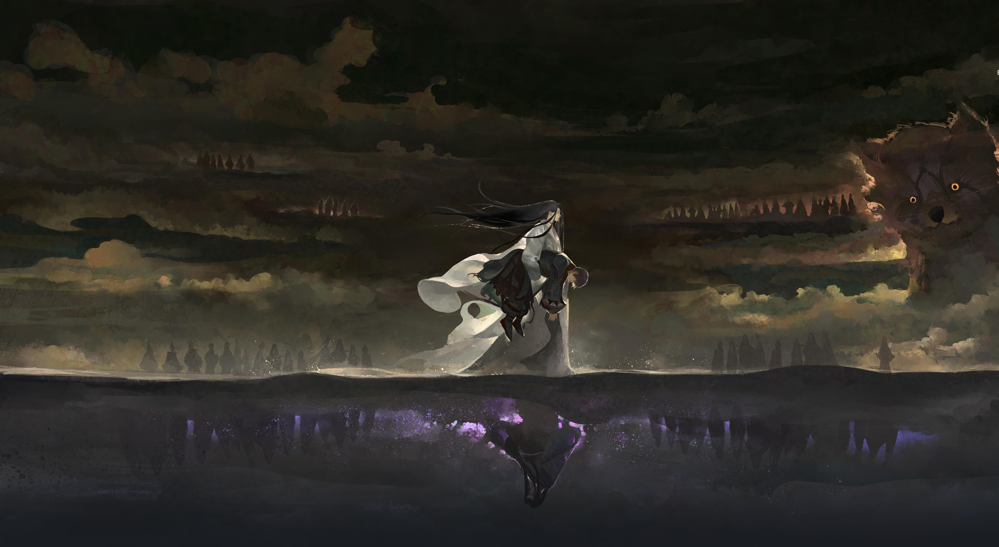

> *How difficult is the perseverance of one person? 
> All of the Gu Immortals here could answer that question. 
> Because among them, some persevered because of responsibility, some persevered because of hatred, some persevered because of excitement, and some persevered because of love… 
> And Fang Yuan's answer? 
> He was still expressionless, he continued to move forward relentlessly. 
> I had once screamed, gradually, I lost my voice. 
> I had once cried, gradually, I lost my tears. 
> I had once grieved, gradually, I became able to withstand everything. 
> I had once rejoiced, gradually, I became unmoved by the world. 
> And now! 
> All I have left is an expressionless face, my gaze is as tough as a monolith, only perseverance remains in my heart. 
> This is my own, an insignificant character, Fang Yuan's — Perseverance!*

Credit: OSOT
